<p align="center">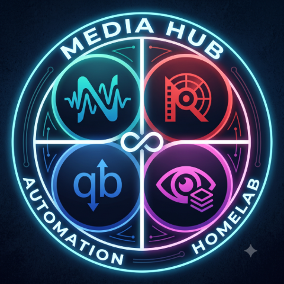</p>

# MediaHub

[](https://github.com/bdlnaredi/mediahub/actions/workflows/ci.yml)
[](LICENSE)
[](https://github.com/bdlnaredi/mediahub/pkgs/container/mediahub)

One friendly web page for the apps on your home media server. See what is downloading, add shows and movies, approve requests from family, check on your server, and get a phone message when something needs you. It runs as a single small Docker container with **no dependencies** to install.

> **Early release (0.11).** It is used daily on the author's server, but it has been built against the documented APIs of the apps below, and some behavior can differ between app versions. See the [compatibility table](#compatibility) for what has been checked against a real app. Bug reports with the app version are very welcome.

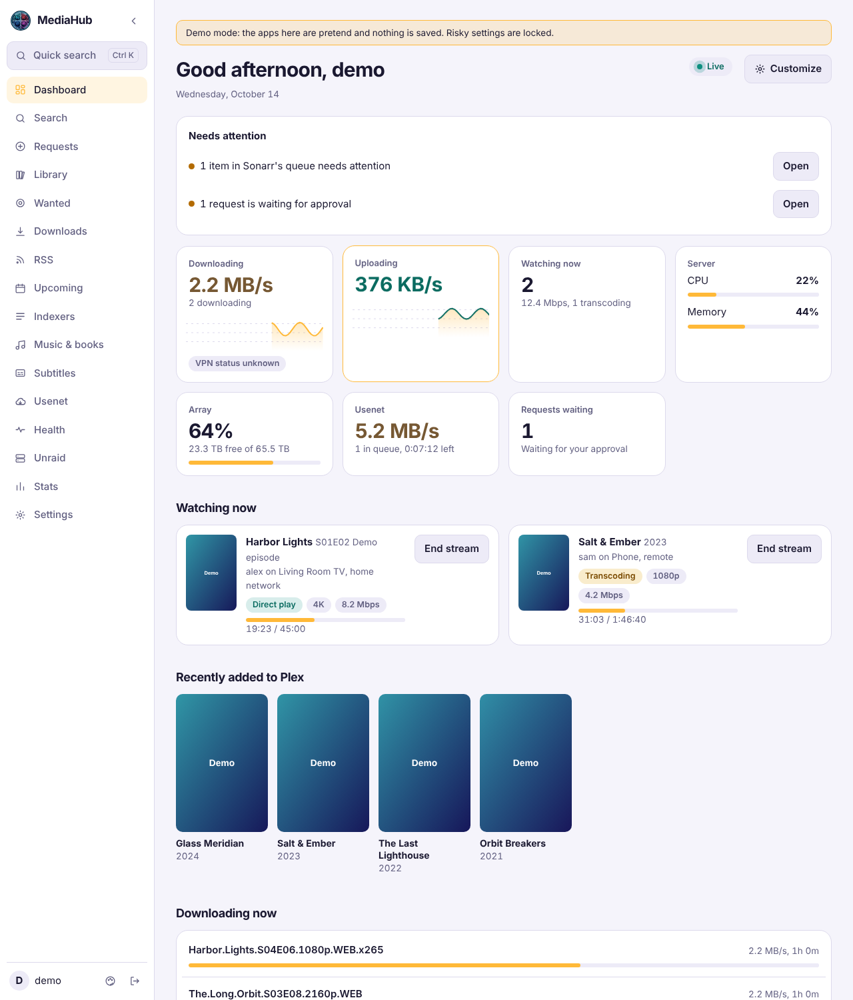

## What it does

- **Dashboard:** updates by itself every second (a "Live" badge shows the connection). Live tiles for download and upload speed with graphs, who is watching on Plex or Jellyfin (poster, progress, direct play or transcoding, quality, bandwidth, and an end-stream button for admins), server CPU, memory and array space, Usenet speed and requests waiting. It also lists what is downloading, how long each app has been online over the last 48 hours, what is coming up, and a "needs attention" list. Each person can hide and reorder sections.
- **Downloads (qBittorrent):** filters, search, select several, pause and resume, categories and tags, file selection, speed limits and schedule, history, seeding rules, and a chip showing which show or movie a download belongs to.
- **RSS (qBittorrent):** read feeds, mark as read, download one or many articles, and manage auto-download rules with a preview.
- **Sonarr and Radarr:** search and add, a library browser with many filters and sorts, a show window with seasons and episodes where you can monitor or unmonitor any of them, a Wanted list, upcoming releases as a list or a month calendar, and automatic or interactive searches.
- **Library bulk edit:** tick many shows or movies, then monitor or unmonitor them, change the quality profile, search, remove, or (for Sonarr) apply a preset such as *latest season only* or *future episodes only*.
- **Requests (Seerr):** family members ask for something (and pick which seasons), you approve it, and they get a message when it is ready. Optional per-person limits, automatic approval for people you trust, and a **Report a problem** button that tells you and searches again.
- **Music and books (Lidarr, Readarr):** your artists and authors, search and add, monitor, and search for what is missing.
- **Subtitles (Bazarr):** what is missing subtitles, with a Search button per item or for everything shown.
- **Usenet (SABnzbd):** the queue, history with retry, and adding an NZB file or address.
- **Indexers:** Jackett search, and Prowlarr indexer health with a test button.
- **Health:** one page with warnings from Sonarr, Radarr, Lidarr, Readarr and Prowlarr, stuck downloads, missing counts and disk space.
- **Slow downloads while Plex or Jellyfin streams:** qBittorrent's alternative speed limits switch on while someone is watching, and back when they stop.
- **Profiles:** per-person app access and permissions (for example "view only"), two-step sign-in, signed-in devices, and an activity log.
- **Sign in with Plex:** people on your Plex server sign in with their Plex account (in Plex's own window, so MediaHub never sees their password). They get a regular profile with only the apps and abilities you choose. Admins still use their MediaHub password.
- **Alerts:** messages through ntfy, Telegram, Discord, Pushover, Gotify, a webhook or email, for finished downloads, apps going offline, a full array, the VPN dropping, new requests and problem reports, plus an optional weekly newsletter. The newsletter (new in the library with posters, coming up, numbers) goes to every channel; email gets an HTML version.
- **Artwork-first UI** built from your own library: a featured hero with backdrops, poster rows, a moving poster wall, a blurred backdrop glowing behind every page, posters that lean toward the pointer, and a phone layout with a bottom dock. Everything honours "reduce motion".
- **Sign-in wallpaper from your library.** MediaHub saves a rotating set of backdrops from Sonarr and Radarr and shows them behind the sign-in card (never titles). Pick "Built-in scenes" in Settings, then Account, if you do not want your artwork visible to anyone who can open the sign-in page. Your own JPG, PNG or WebP files in `data/wallpapers` are included too.
- **Forgot password.** Profiles can save a recovery email. MediaHub sends a single-use link (valid 30 minutes, signs the profile out everywhere) through the email alert channel you already set up.
- **Status pages:** a private read-only link for a wall tablet that refreshes by itself and shows only the sections you pick, without signing in: an all-clear banner, 48-hour uptime bars per app, speed graph, and optionally how many people are watching (titles only, never names).
- **Backups:** an encrypted backup file, plus automatic daily copies inside the data folder.
- **Also:** Plex and Jellyfin (who is watching, recently added, end a stream), Tautulli stats with poster grids and charts (plays per day, busiest hours, devices, top viewers), Unraid (CPU, memory, array, disks, shares, containers), quick search (`Ctrl+K`), light and dark themes, five languages, and install-to-home-screen on a phone.

| Downloads | Library |
| --- | --- |
| 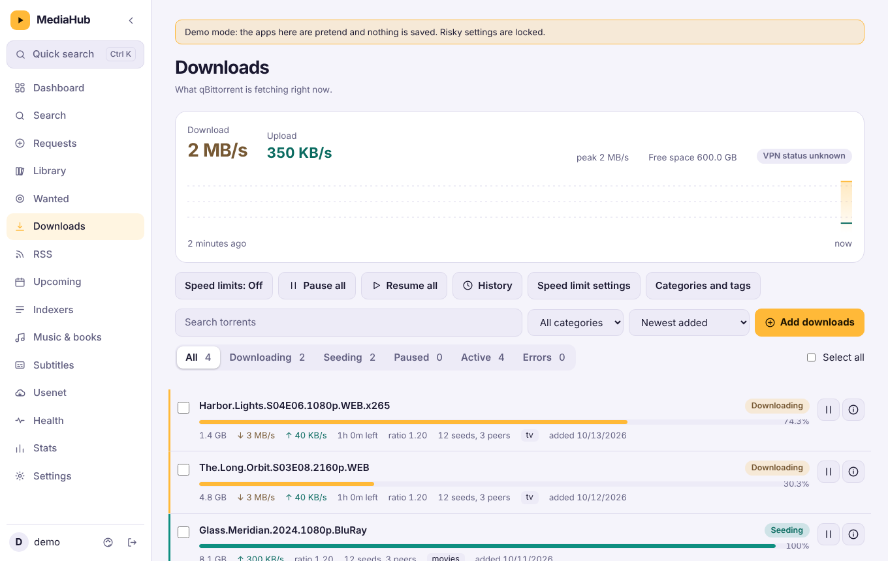 | 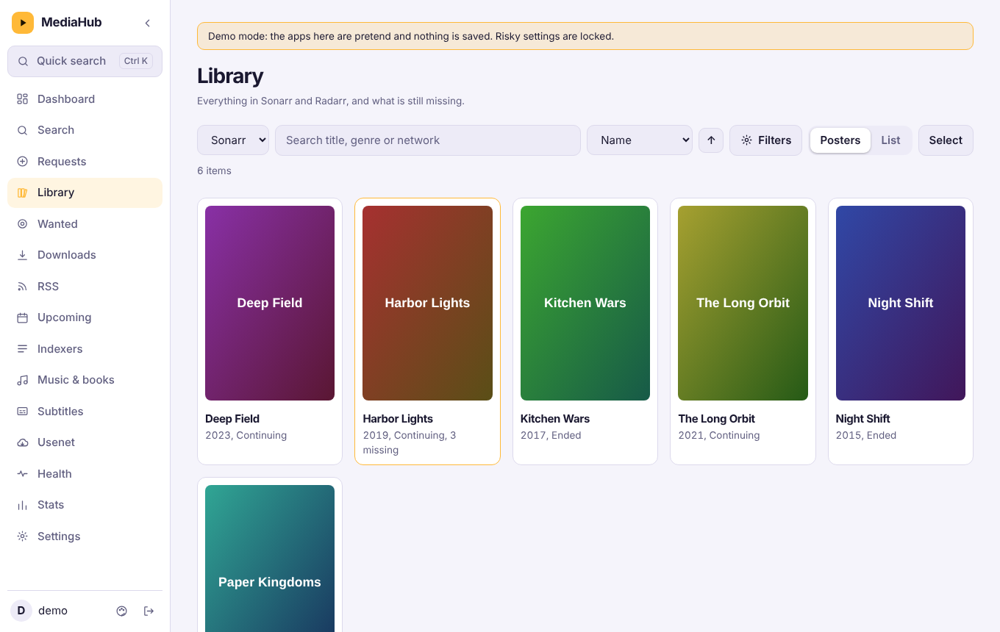 |
| **Bulk edit** | **Health** |
| 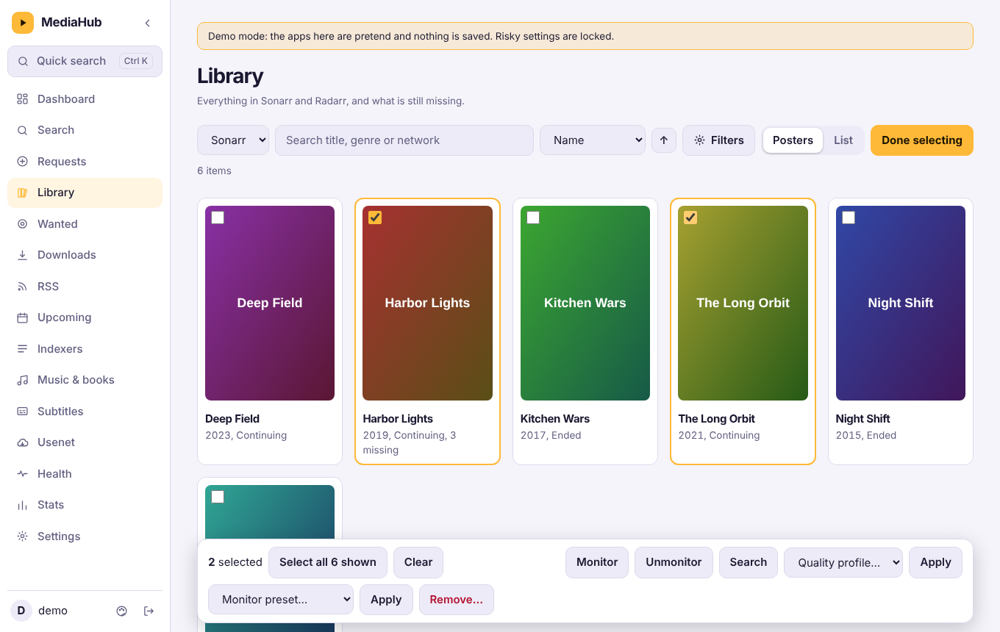 | 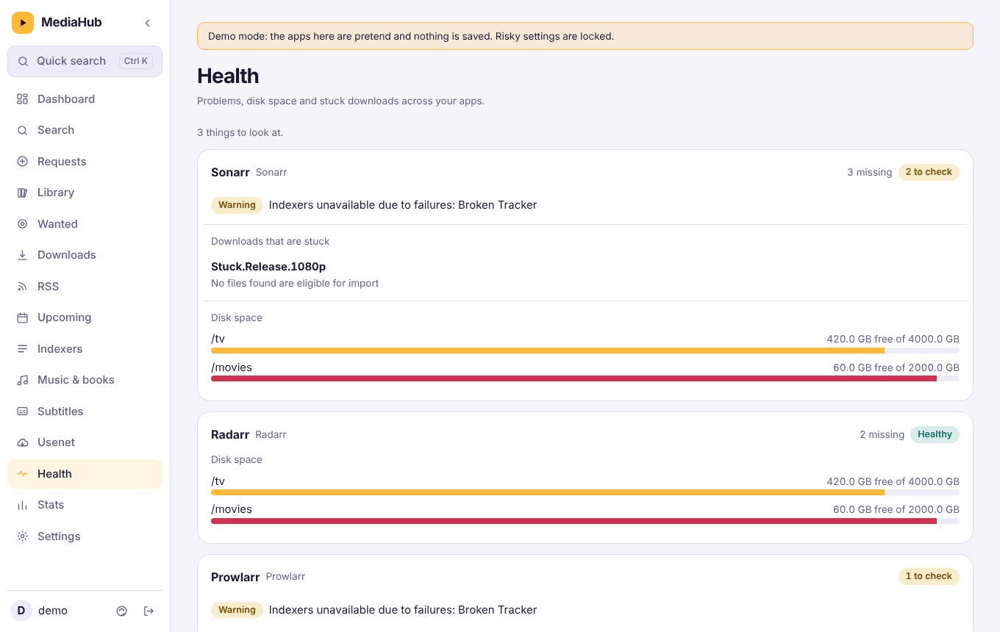 |
| **Requests** | **Music and books** |
| 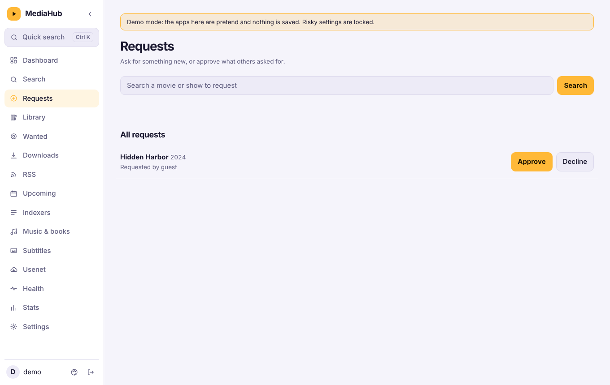 | 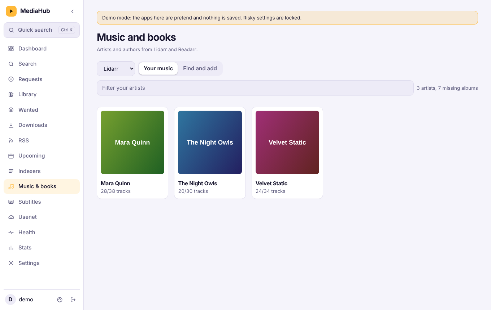 |
| **RSS** | **Calendar** |
| 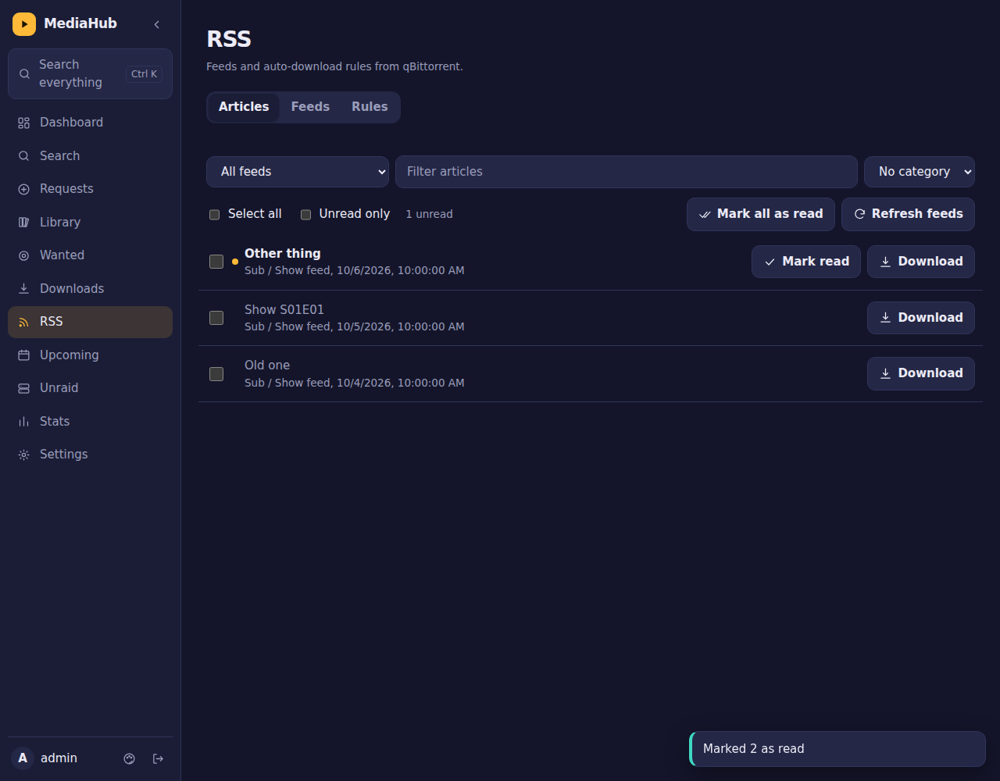 | 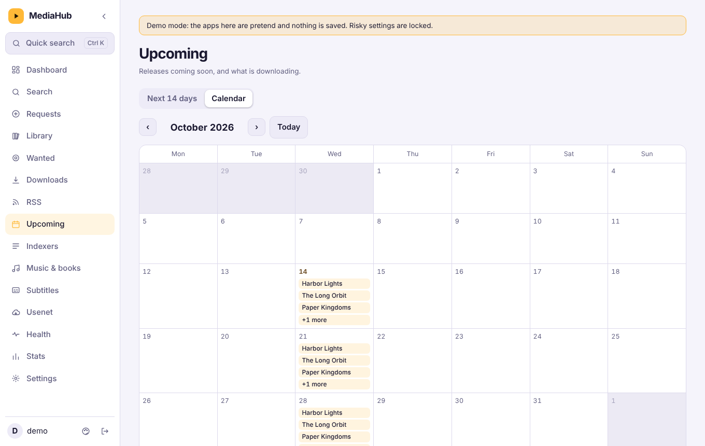 |
| **Stats** | **Status page** |
| 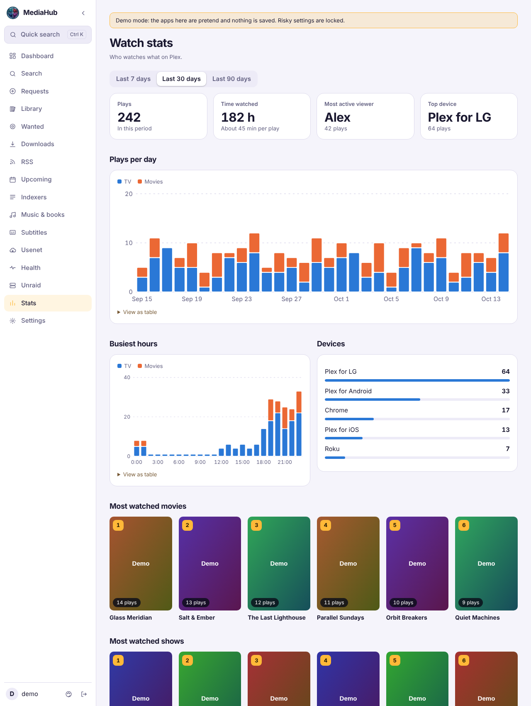 | 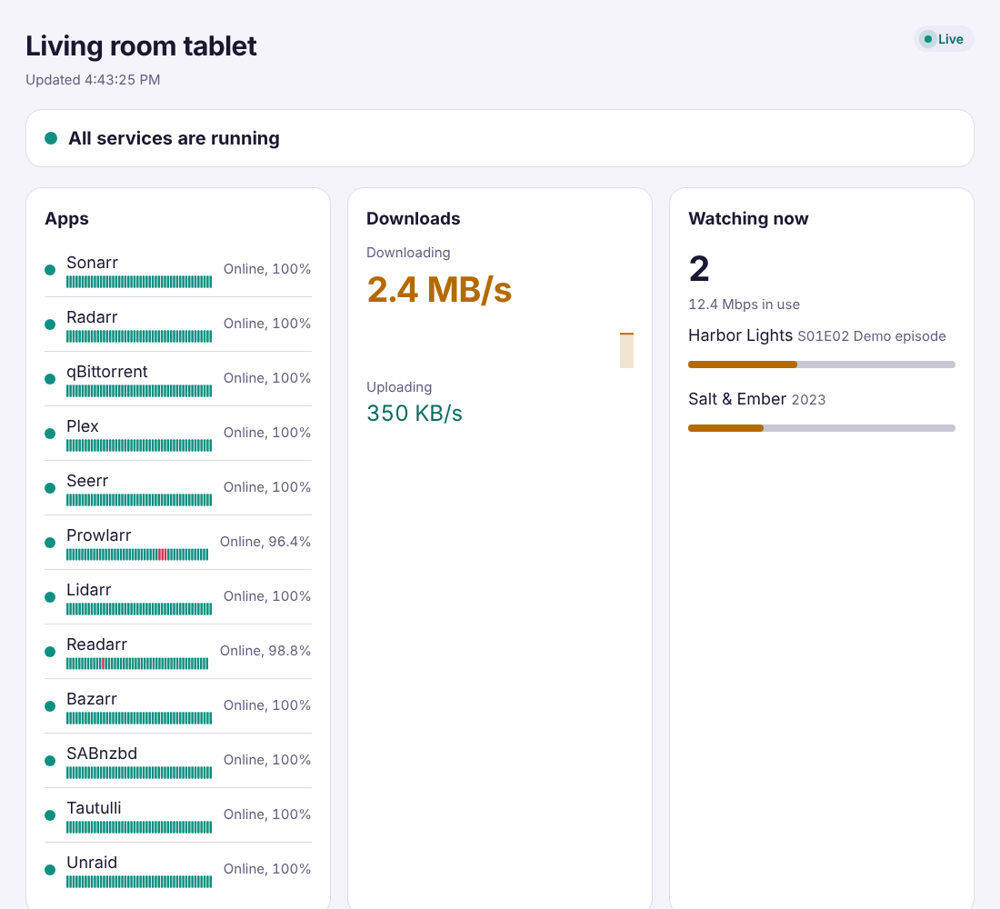 |

*Screenshots use the built-in demo data.*

## Try the demo

Want to look around first? The demo runs MediaHub against built-in pretend apps. Nothing is saved, and settings that could be abused (users, passwords, alert addresses, backups, adding apps) are locked.

```
docker run --rm -p 5080:5080 -e DEMO=1 ghcr.io/bdlnaredi/mediahub:latest
```

Open `http://localhost:5080` and sign in as `demo` with `demo-mediahub` (admin), or `guest` with `guest-mediahub` (a regular profile). Without Docker: `DEMO=1 node server.js`. Do not point a real data folder at a demo container, and do not leave a demo reachable from the internet if you do not want strangers poking at it.

## Quick start

You need Docker (or Unraid) and a folder to keep MediaHub's data.

### Docker Compose

```yaml
services:
  mediahub:
    image: ghcr.io/bdlnaredi/mediahub:latest
    container_name: mediahub
    restart: unless-stopped
    ports:
      - "5080:5080"
    environment:
      - PUID=1000
      - PGID=1000
    volumes:
      - ./data:/data
    security_opt:
      - no-new-privileges:true
```

```
docker compose up -d
```

### Docker run

```
docker run -d --name mediahub --restart unless-stopped \
  -p 5080:5080 -e PUID=1000 -e PGID=1000 \
  -v /path/to/mediahub-data:/data \
  ghcr.io/bdlnaredi/mediahub:latest
```

### Unraid

Copy `unraid/mediahub.xml` to `/boot/config/plugins/dockerMan/templates-user/` on your server, then in the Docker tab choose **Add Container** and pick **mediahub** from the template list. The defaults (`PUID` 99, `PGID` 100, data in `/mnt/user/appdata/mediahub`) suit Unraid.

### First run

Open `http://YOUR-SERVER-IP:5080`. The first screen creates the admin account (password of 8 or more characters). Then go to **Settings, then Apps** and add your apps. Pages appear in the menu as soon as the matching app is connected.

If the port can be reached by anyone besides you, set `SETUP_TOKEN` first (see below) so nobody else can create the admin account.

## Settings you can change

| Variable | Default | What it does |
| --- | --- | --- |
| `PORT` | `5080` | Port inside the container. |
| `DATA_DIR` | `/data` | Where accounts, saved apps and the encryption key are kept. |
| `PUID` / `PGID` | `1000` / `1000` | The user and group that own the data folder. On Unraid use `99` and `100`. |
| `SETUP_TOKEN` | empty | If set, creating the first admin asks for this code. |
| `TRUST_PROXY` | off | Set to `true` **only** if MediaHub is behind a reverse proxy or tunnel you control. It makes MediaHub believe the proxy's client address and HTTPS headers. Leave it off otherwise. |
| `DEMO` | off | Set to `1` to run the demo described above instead of your real data. |
| `PUBLIC_URL` | learned from the admin | The address people open from password emails, for example `https://media.example.com`. If unset, MediaHub remembers the address the first admin used, and it can be changed in Settings, then Account. |
| `ICON_BASE` | the public dashboard-icons set | Where app logos are loaded from, by your browser, not the server. Set it empty to use only the drawn icons (nothing is requested from the internet), or to a folder of your own that holds `sonarr.svg`, `radarr.svg` and so on. |
| `ALLOWED_ORIGINS` | empty | Comma-separated extra web addresses allowed to sign in, if a proxy changes the `Host` header, for example `https://media.example.com`. |

## Connecting your apps

| App | Address example | What you need |
| --- | --- | --- |
| Sonarr / Radarr | `http://192.168.1.10:8989` / `:7878` | API key (Settings, General). |
| qBittorrent | `http://192.168.1.10:8080` | The web page username and password. |
| Jackett / Prowlarr | `:9117` / `:9696` | API key. |
| Seerr (Overseerr / Jellyseerr) | `:5055` | API key (Settings, General). |
| Plex | `:32400` | Your Plex token. |
| Jellyfin | `:8096` | An API key (Dashboard, then API Keys). |
| Tautulli | `:8181` | API key (Settings, Web Interface). |
| SABnzbd | `:8080` | API key (Config, General). |
| Unraid (7.2 or newer) | your Unraid web address | An API key from Settings, Management Access, API Keys. |
| Bazarr / Lidarr / Readarr | `:6767` / `:8686` / `:8787` | API key (Settings, General). |

Settings, then Apps has a **Test connection** button and hints for each app. Use your server's address on your network, not names that only work inside Docker.

Some features depend on fields that differ between app versions (for example Unraid disk details, parity control and container logs, or ending a Plex stream, which needs Plex Pass). When something is not available MediaHub shows a short note and carries on.

## Compatibility

"Author's server" means the feature has been used against that real app. "Test fakes" means MediaHub's own tests pass against a pretend copy of the app that follows its documented API, but nobody has confirmed it against the real thing yet. If you try one of those, please open an issue with the result and the app version, good or bad.

| App | API used | Tested against |
| --- | --- | --- |
| Sonarr | v3 API (Sonarr v3 and v4) | Author's server for search, add, library and monitoring. Bulk edit and presets: test fakes. |
| Radarr | v3 API (Radarr v4 and v5) | Author's server for search, add, library and monitoring. Bulk edit: test fakes. |
| qBittorrent | Web API v2 (4.1 and 5.x) | Author's server (qBittorrent behind a VPN). Slowing downloads during streams: test fakes. |
| Jackett | Torznab API | Author's server. |
| Seerr / Overseerr / Jellyseerr | v1 API | Author's server for search and requests. Season choice and problem reports: test fakes. |
| Unraid 7.2 | GraphQL API | Author's server. |
| Plex | Local server API with a token | Test fakes. |
| Jellyfin | Local server API with an API key | Test fakes only. |
| Tautulli | v2 API | Test fakes. |
| SABnzbd | JSON API (3.x and 4.x) | Test fakes. |
| Prowlarr | v1 API | Test fakes. |
| Lidarr / Readarr | v1 API | Test fakes. |
| Bazarr | REST API (1.x) | Test fakes. |

Everything above runs on Node.js 20 or newer in the container (the image uses Node 22) and works in current Chrome, Firefox, Safari and Edge.

## Languages and accessibility

Choose a language under the palette icon (Appearance): English, Español, Deutsch, Français and हिन्दी. Texts that are not translated yet stay in English. Adding or improving a language is easy and does not need coding: see [CONTRIBUTING.md](CONTRIBUTING.md).

The page works with a keyboard (there is a skip link, dialogs keep focus inside and return it when closed), controls have names for screen readers, and text colors meet the WCAG AA contrast ratio in both themes with every accent color. This was checked with a script, not by a full audit, so reports are welcome.

## HTTPS and remote access

Do not forward the port straight to the internet over plain HTTP. Good options:

- **Tailscale:** install it on your server and your devices and open MediaHub over your private network. Nothing is exposed.
- **Cloudflare Tunnel:** gives you an HTTPS address without opening any port. Add an access rule so only people you approve can reach the sign-in page.
- **A reverse proxy** (Nginx Proxy Manager, Caddy, Traefik) with a certificate.

When you use a proxy or tunnel, set `TRUST_PROXY=true`. If sign-in says "Blocked a request from another website", the proxy is changing the `Host` header: either pass the original host through or add your address to `ALLOWED_ORIGINS`.

The live dashboard uses one long-lived connection (`/api/live`). MediaHub already asks proxies not to buffer it. If the "Live" badge keeps saying "Reconnecting" behind Nginx, add `proxy_buffering off;` for that path. The page keeps working either way, only a little slower.

## Safety and your data

- Passwords are hashed. The keys and passwords of your other apps are encrypted on disk with a key stored beside them in `secret.key`.
- Sign-ins are rate limited, cookies are same-site and `HttpOnly`, requests from other websites are blocked, and a strict content security policy is sent.
- Profiles can be limited on the server, not just hidden in the page.
- Two-step sign-in (an authenticator app plus one-time recovery codes) is available for every profile and recommended for admins. An admin can switch it off for someone who lost their phone.
- Status page links use a long secret in the address, show only what you chose, can be removed at any time, and are rate limited against guessing.
- Saves are written atomically, and an automatic copy (`db.json.bak`) is kept. A damaged database is never silently replaced.

Everything lives in your data folder: `db.json`, `db.json.bak`, `secret.key`, `sessions.json`, `uptime.json` and a `backups` folder when automatic backups are on. **Back up that whole folder**, or use **Settings, then Backup** for a passphrase-protected file. Keep backups private, because they contain the keys of your other apps. See [SECURITY.md](SECURITY.md).

## Updating

```
docker compose pull && docker compose up -d
```

Your data folder is kept. Release notes are in [CHANGELOG.md](CHANGELOG.md). To pin a version, use a tag such as `ghcr.io/bdlnaredi/mediahub:0.10.0` instead of `latest`.

## Troubleshooting

- **"Permission denied" or it cannot save:** set `PUID` and `PGID` to the owner of your data folder.
- **A page is missing from the menu:** connect the matching app in Settings, then Apps.
- **Posters are blank:** posters load from the internet, so the browser needs internet access.
- **An app shows "Not reachable":** check the address and port, and that MediaHub can reach it from inside its container.

## Disclaimer

MediaHub is an independent project and is not affiliated with or endorsed by the makers of Sonarr, Radarr, qBittorrent, Plex, Unraid or any other app it can connect to. Those names belong to their owners. MediaHub only talks to software you run yourself, and does not host, index or provide any content. You are responsible for how you use your own server and for following the laws and terms that apply to you.

## Contributing

Ideas, bug reports and pull requests are welcome. See [CONTRIBUTING.md](CONTRIBUTING.md). To run it locally you only need Node.js 20 or newer:

```
DATA_DIR=./data PORT=5080 node server.js
npm test
```

## Android app

There is an Android app named **MediaHub** that opens your server full screen. Build it from GitHub with one button, or in Android Studio. See [docs/ANDROID.md](docs/ANDROID.md).

## License

MediaHub is free software, released under the [GNU General Public License, version 3 or (at your option) any later version](LICENSE).

You may use, study, change and share it. If you share a changed version, you must share it under the same license and make its source available. There is no warranty.

Versions up to 0.14.12 were released under the MIT license, and anyone who received those versions keeps the rights the MIT license gave them for those versions.
