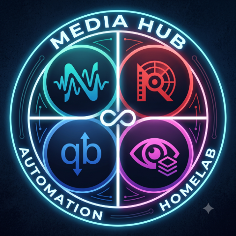

# MediaHub


[](https://github.com/bdlnaredi/mediahub/actions/workflows/ci.yml)
[](LICENSE)
[](https://github.com/bdlnaredi/mediahub/pkgs/container/mediahub)

One friendly web page for the apps on your home media server. See what is downloading, add shows and movies, approve requests from family, check on your server, and get a phone message when something needs you. It runs as a single small Docker container with **no dependencies** to install.

> **Early release (0.9).** It is used daily, but it has been built against the documented APIs of the apps below, and some behavior can differ between app versions. Bug reports with the app version are very welcome.


## What it does

- **Dashboard:** live download speed and graph, server CPU and memory, which apps are online, what is coming up, what is downloading, who is watching on Plex, and a "needs attention" list. Each person can hide and reorder sections.
- **Downloads (qBittorrent):** filters, search, select several, pause and resume, categories and tags, file selection, speed limits and schedule, history, seeding rules, and a chip showing which show or movie a download belongs to.
- **RSS (qBittorrent):** read feeds, mark as read, download one or many articles, and manage auto-download rules with a preview.
- **Sonarr and Radarr:** search and add, library browser with many filters and sorts, a show window with seasons and episodes where you can monitor or unmonitor any of them, a Wanted list, upcoming releases as a list or a month calendar, and automatic or interactive searches.
- **Requests (Seerr):** family members ask for something, you approve it, and they get a message when it is ready.
- **Profiles:** per-person app access and permissions (for example "view only"), signed-in devices, and an activity log.
- **Alerts:** phone messages through ntfy, Telegram or Discord for finished downloads, apps going offline, a full array, the VPN dropping and new requests.
- **Also:** Plex (who is watching, recently added), Tautulli stats, SABnzbd, Jackett search, Unraid (CPU, memory, array, disks, shares, containers), encrypted backup and restore, quick search (`Ctrl+K`), light and dark themes, and install-to-home-screen on a phone.

| Downloads | Library |
| --- | --- |
|  |  |
| **RSS** | **Calendar** |
|  |  |

*Screenshots use demo data.*

## Quick start

You need Docker (or Unraid) and a folder to keep MediaHub's data.

### Docker Compose

```yaml
services:
  mediahub:
    image: ghcr.io/bdlnaredi/mediahub:latest
    container_name: mediahub
    restart: unless-stopped
    ports:
      - "8080:8080"
    environment:
      - PUID=1000
      - PGID=1000
    volumes:
      - ./data:/data
    security_opt:
      - no-new-privileges:true
```

```
docker compose up -d
```

### Docker run

```
docker run -d --name mediahub --restart unless-stopped \
  -p 8080:8080 -e PUID=1000 -e PGID=1000 \
  -v /path/to/mediahub-data:/data \
  ghcr.io/bdlnaredi/mediahub:latest
```

### Unraid

Copy `unraid/mediahub.xml` to `/boot/config/plugins/dockerMan/templates-user/` on your server, then in the Docker tab choose **Add Container** and pick **mediahub** from the template list. The defaults (`PUID` 99, `PGID` 100, data in `/mnt/user/appdata/mediahub`) suit Unraid.

### First run

Open `http://YOUR-SERVER-IP:8080`. The first screen creates the admin account (password of 8 or more characters). Then go to **Settings, then Apps** and add your apps. Pages appear in the menu as soon as the matching app is connected.

If the port can be reached by anyone besides you, set `SETUP_TOKEN` first (see below) so nobody else can create the admin account.

## Settings you can change

| Variable | Default | What it does |
| --- | --- | --- |
| `PORT` | `8080` | Port inside the container. |
| `DATA_DIR` | `/data` | Where accounts, saved apps and the encryption key are kept. |
| `PUID` / `PGID` | `1000` / `1000` | The user and group that own the data folder. On Unraid use `99` and `100`. |
| `SETUP_TOKEN` | empty | If set, creating the first admin asks for this code. |
| `TRUST_PROXY` | off | Set to `true` **only** if MediaHub is behind a reverse proxy or tunnel you control. It makes MediaHub believe the proxy's client address and HTTPS headers. Leave it off otherwise. |
| `ALLOWED_ORIGINS` | empty | Comma-separated extra web addresses allowed to sign in, if a proxy changes the `Host` header, for example `https://media.example.com`. |

## Connecting your apps

| App | Address example | What you need |
| --- | --- | --- |
| Sonarr / Radarr | `http://192.168.1.10:8989` / `:7878` | API key (Settings, General). |
| qBittorrent | `http://192.168.1.10:8080` | The web page username and password. |
| Jackett / Prowlarr | `:9117` / `:9696` | API key. |
| Seerr (Overseerr / Jellyseerr) | `:5055` | API key (Settings, General). |
| Plex | `:32400` | Your Plex token. |
| Tautulli | `:8181` | API key (Settings, Web Interface). |
| SABnzbd | `:8080` | API key (Config, General). |
| Unraid (7.2 or newer) | your Unraid web address | An API key from Settings, Management Access, API Keys. |
| Bazarr / Lidarr / Readarr | `:6767` / `:8686` / `:8787` | API key. Status and an Open link only for now. |

Settings, then Apps has a **Test connection** button and hints for each app. Use your server's address on your network, not names that only work inside Docker.

Some features depend on fields that differ between app versions (for example Unraid disk details, parity control and container logs, or ending a Plex stream, which needs Plex Pass). When something is not available MediaHub shows a short note and carries on.

## HTTPS and remote access

Do not forward the port straight to the internet over plain HTTP. Good options:

- **Tailscale:** install it on your server and your devices and open MediaHub over your private network. Nothing is exposed.
- **Cloudflare Tunnel:** gives you an HTTPS address without opening any port. Add an access rule so only people you approve can reach the sign-in page.
- **A reverse proxy** (Nginx Proxy Manager, Caddy, Traefik) with a certificate.

When you use a proxy or tunnel, set `TRUST_PROXY=true`. If sign-in says "Blocked a request from another website", the proxy is changing the `Host` header: either pass the original host through or add your address to `ALLOWED_ORIGINS`.

## Safety and your data

- Passwords are hashed. The keys and passwords of your other apps are encrypted on disk with a key stored beside them in `secret.key`.
- Sign-ins are rate limited, cookies are same-site and `HttpOnly`, requests from other websites are blocked, and a strict content security policy is sent.
- Profiles can be limited on the server, not just hidden in the page.
- Saves are written atomically, and an automatic copy (`db.json.bak`) is kept. A damaged database is never silently replaced.

Everything lives in your data folder: `db.json`, `db.json.bak`, `secret.key` and `sessions.json`. **Back up that whole folder**, or use **Settings, then Backup** for a passphrase-protected file. Keep backups private, because they contain the keys of your other apps. See [SECURITY.md](SECURITY.md).

## Updating

```
docker compose pull && docker compose up -d
```

Your data folder is kept. Release notes are in [CHANGELOG.md](CHANGELOG.md). To pin a version, use a tag such as `ghcr.io/bdlnaredi/mediahub:0.9.0` instead of `latest`.

## Troubleshooting

- **"Permission denied" or it cannot save:** set `PUID` and `PGID` to the owner of your data folder.
- **A page is missing from the menu:** connect the matching app in Settings, then Apps.
- **Posters are blank:** posters load from the internet, so the browser needs internet access.
- **An app shows "Not reachable":** check the address and port, and that MediaHub can reach it from inside its container.

## Disclaimer

MediaHub is an independent project and is not affiliated with or endorsed by the makers of Sonarr, Radarr, qBittorrent, Plex, Unraid or any other app it can connect to. Those names belong to their owners. MediaHub only talks to software you run yourself, and does not host, index or provide any content. You are responsible for how you use your own server and for following the laws and terms that apply to you.

## Contributing

Ideas, bug reports and pull requests are welcome. See [CONTRIBUTING.md](CONTRIBUTING.md). To run it locally you only need Node.js 20 or newer:

```
DATA_DIR=./data PORT=8080 node server.js
npm test
```

## License

[MIT](LICENSE)
